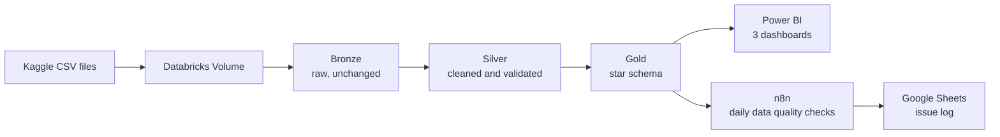
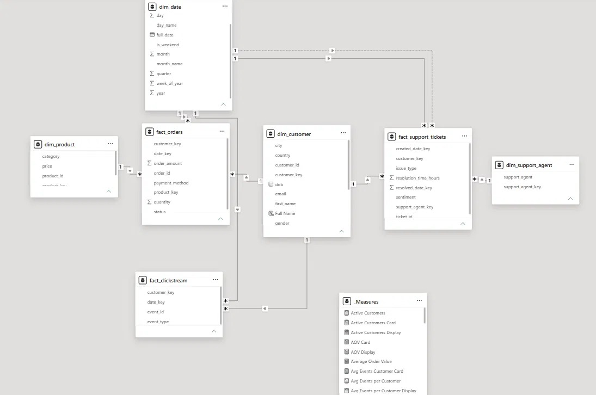
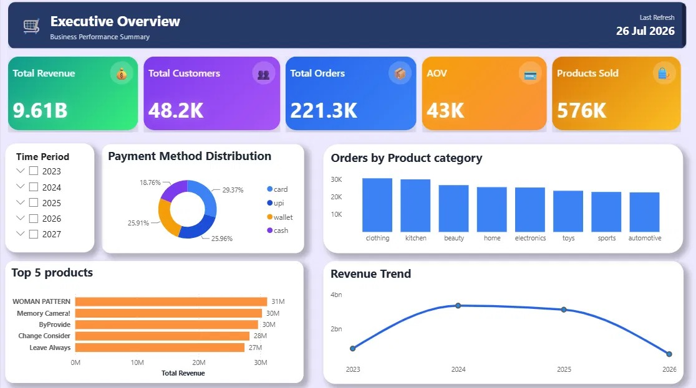
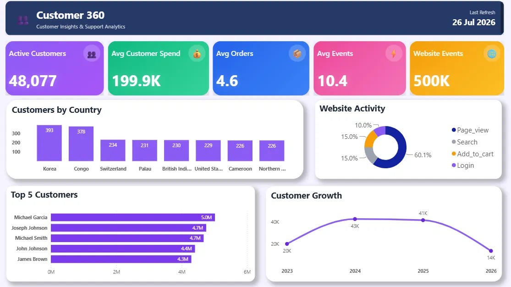
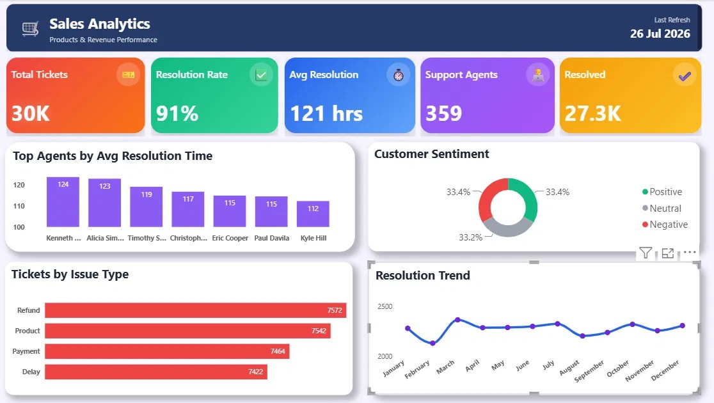
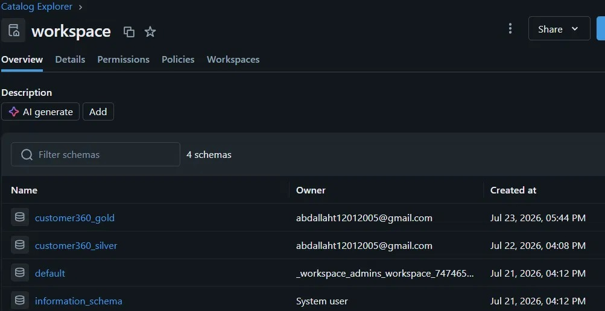

# Customer360 Analytics Platform


An end-to-end analytics project that turns five dirty source files (customers, orders, products, support tickets, clickstream) into three Power BI dashboards, using a Medallion Architecture (Bronze → Silver → Gold) on Databricks.

> **Note on the data:** the source is a synthetic Kaggle dataset, so the numbers below describe this dataset, not a real business. The pipeline and dashboards are static (no live source), see [Limitations](#limitations).

---

## Business Problem

A business collects data from several systems: customers, orders, products, support tickets and website clickstream. Each source has its own quality problems, so leadership cannot trust a single number.

The goal: build a pipeline that cleans and validates the raw data once, models it for analysis, and answers questions from three audiences:

| Audience | Question | Dashboard |
|---|---|---|
| Leadership | How is the business performing over time, and where does revenue come from? | Executive Overview |
| Marketing / CRM | Who are our customers, how much do they spend, and how do they behave on the site? | Customer360 Analytics |
| Support managers | How fast and how well do we resolve tickets, and which issues drive volume? | Support Analytics |

---

## Key Results

Figures shown in the Power BI dashboards (see [`documentation/Customer360_Portfolio.pdf`](documentation/Customer360_Portfolio.pdf)):

- 9.61B total revenue, ~48K customers, 221.3K orders, revenue trend for 2023–2026
- 30K support tickets handled by 359 agents, 91% resolution rate, 121-hour average resolution time
- 4 data-driven recommendations with a 90-day action plan, based on the findings <!-- VERIFY: link or add the document that holds the plan -->

<!-- CONFIRM: the PDF shows 48.2K customers on the Executive Overview but 48,077 on the Customer 360 page. Pick one number and use it everywhere. -->

---

## Data Quality Findings

The raw files are intentionally dirty. Problems found during profiling (`notebooks/01_Data_Profiling.py`) and fixed in the Silver layer (`notebooks/02_Bronze_to_Silver.sql`):

| Table | Problem found | Fix in Silver |
|---|---|---|
| customers | Duplicate `customer_id` values | Keep one row per `customer_id` |
| customers | Digits inside first/last names; inconsistent casing and spacing | Strip digits, `TRIM`, `INITCAP` |
| orders | `quantity` stored as text: `'five'`, `'2.0'`, blanks, negative values | Map to integers; blanks and negatives become `NULL` |
| orders | `order_amount` stored as text with thousands separators; some negative values | Remove separators, cast to `DOUBLE`, validate against `unit_price × quantity` |
| orders | Status typos (`suc`, `ref`, `fail`) | Standardize to `success`, `refunded`, `failed` |
| orders | Payment-method typos (`crad`, `c@rd`, `cd`, `wall-et`) | Standardize to `card`, `wallet`, `upi`, `cash` |
| tickets, clickstream | Column names with spaces and special characters | Normalize to `snake_case` while loading |

Headline numbers from the run:

- 300K+ order records profiled <!-- VERIFY against your notebook output before publishing -->
- 1,734 duplicate customer IDs <!-- VERIFY -->
- 1,040 customers with a missing email <!-- VERIFY -->
- 11,163 orders flagged for customer-related data issues <!-- VERIFY and describe the rule that flags them -->

---

## Architecture



| Layer | What happens | Notebook |
|---|---|---|
| Bronze | Raw files stored as tables in the `default` schema, with no business logic, so the original data is always available | Loaded at the start of `02_Bronze_to_Silver.sql`, profiled in `01_Data_Profiling.py` <!-- CONFIRM which notebook loads each raw table --> |
| Silver | Cleaning, standardization, de-duplication and validation rules in SQL | `02_Bronze_to_Silver.sql` |
| Gold | Dimensions and facts with surrogate keys, ready for Power BI | `03_Silver_to_gold.sql` |

---

## Data Model (Gold layer)

Star schema with **3 fact tables** and **4 dimension tables**.

| Table | Type | Key columns |
|---|---|---|
| `fact_orders` | Fact | `order_id`, `customer_key`, `product_key`, `date_key` |
| `fact_support_tickets` | Fact | `customer_key`, `support_agent_key`, `created_date_key`, `resolved_date_key` |
| `fact_clickstream` | Fact | `customer_key`, `date_key` |
| `dim_customer` | Dimension | `customer_key` (surrogate), `customer_id` |
| `dim_product` | Dimension | `product_key` (surrogate), `product_id` |
| `dim_support_agent` | Dimension | `support_agent_key` (surrogate) |
| `dim_date` | Dimension | `date_key` (`yyyyMMdd`), `full_date` |

`fact_support_tickets` joins `dim_date` twice (created date and resolved date), which is why resolution time can be measured.



---

## KPIs and Why They Matter

| KPI | Business question it answers |
|---|---|
| Revenue, Orders, Customers | Is the business growing, and how fast? |
| Revenue by category and payment method | Where does revenue come from? |
| Average spend, average orders per customer | How valuable is a typical customer? |
| Customer growth | Are we acquiring customers over time? |
| Website events | How do customers move through the funnel (view, search, add to cart, login)? |
| Resolution rate, average resolution time | Is support fast and effective? |
| Ticket volume and issue types | What drives support demand? |
| Customer sentiment | Are customers satisfied with the outcome? |

<!-- CONFIRM: edit the questions above so they match what you actually intended each KPI to answer. -->

---

## Dashboards

### Executive Overview


### Customer360 Analytics


### Support Analytics


### Databricks Workspace


---

## Power BI: Refresh and Performance

- **Incremental Refresh:** a policy is configured on the large fact tables, so a refresh reloads only recent data instead of the whole table. <!-- VERIFY: name the tables and the window (for example, archive 3 years, refresh last 7 days) -->
- **Performance Analyzer:** used to inspect DAX query time and visual rendering time, so slow visuals and measures can be found and optimized. <!-- VERIFY: add one before/after example if you have it, for example a measure or visual you improved -->

---

## Design Decisions

<!-- CONFIRM: these are draft reasons. Replace each one with your real reasoning. A reviewer will ask. -->

| Decision | Reason |
|---|---|
| Medallion architecture | Raw data stays untouched in Bronze, so a cleaning rule can be changed and re-run without pulling the data from the source again |
| SQL for cleaning and modeling, PySpark for loading and profiling | Cleaning rules are easy to read and review as SQL; PySpark handles file loading and profiling |
| Star schema in Gold | Simple joins and fast aggregations for Power BI |
| Surrogate keys (`customer_key`, `product_key`) | Stable keys that do not depend on source IDs |
| `yyyyMMdd` integer `date_key` | Simple join to a date dimension, supports created vs resolved dates |
| Incremental Refresh policy | Large tables reload only recent data, so refreshes stay fast as the data grows |

---

## Automation: Data Quality Checks with n8n

An n8n workflow connected to Databricks and Google Sheets runs data quality checks on a schedule:

- Row counts and quality checks on 7 Gold-layer tables (884K+ rows in total) <!-- VERIFY -->
- Results are grouped by issue type and logged automatically in Google Sheets
- One configuration node holds the schema, the table list and the check settings, so adding a table or a check does not require editing every step

The exported workflow is in [`automation/`](automation/) <!-- ADD: automation/n8n_data_quality_workflow.json (remove credentials before uploading) -->

---

## How to Run

1. Create a Databricks workspace (the notebooks were built with Unity Catalog).
2. Download the dataset from Kaggle (link below) and upload the CSV files to a Volume at `/Volumes/workspace/default/customer360_raw/`.
3. Run the notebooks in order:
   1. `notebooks/01_Data_Profiling.py`
   2. `notebooks/02_Bronze_to_Silver.sql`
   3. `notebooks/03_Silver_to_gold.sql`
4. Connect Power BI to the `customer360_gold` schema and build the model from the table list above.

<!-- CONFIRM: the notebooks reference some file names (for example support_tickets_30000_dirty.csv and clickstream_500k_events.csv). List the exact files expected. Also add the .pbix file to the repo, or say it is not included. -->

---

## Limitations

- **The data is synthetic and static.** There is no live source, so the dashboards do not refresh from new data.
- **Row-Level Security is not implemented** in the Power BI model yet.
- **Incremental Refresh is configured, but the report is not published with a scheduled refresh** <!-- VERIFY: change this if you did publish it and schedule the refresh -->, and the source data is static, so there is nothing new to refresh.
- The n8n checks run on a schedule against the static dataset; they demonstrate the approach rather than monitor a production system.

---

## Next Steps

- Row-Level Security, and publishing with a Scheduled Refresh in the Power BI Service
- Incremental loading and Delta Live Tables
- Move quality checks into the pipeline itself (for example, expectations in Delta Live Tables)
- CI/CD deployment of the notebooks
- Streaming ingestion for clickstream

---

## What I Learned

- Designing a Bronze/Silver/Gold pipeline and keeping raw data untouched
- Writing validation rules and checking them against expected values (for example `unit_price × quantity` against the stored order amount)
- Modeling a star schema, including a date dimension used twice in one fact table
- Turning KPIs into dashboards for different audiences
- Configuring an Incremental Refresh policy and using Performance Analyzer to find slow DAX queries and visuals

---

## Repository Structure

```text
customer360-analytics-platform
├── notebooks
│   ├── 01_Data_Profiling.py
│   ├── 02_Bronze_to_Silver.sql
│   └── 03_Silver_to_gold.sql
├── screenshots
├── documentation
│   └── Customer360_Portfolio.pdf
├── automation          <!-- add: n8n workflow export -->
├── README.md
├── LICENSE
└── .gitignore
```

---

## Dataset

[Customer 360 Synthetic Dataset](https://www.kaggle.com/datasets/vinaykandimalla/customer-360) from Kaggle: CRM customers, orders, product catalog, support tickets and clickstream events. The data is intentionally dirty and designed for data cleaning and ETL practice.

---

## Author

**Abdallah Tarek**, Data Analyst
[LinkedIn](https://www.linkedin.com/in/abdallaatarekk/)
