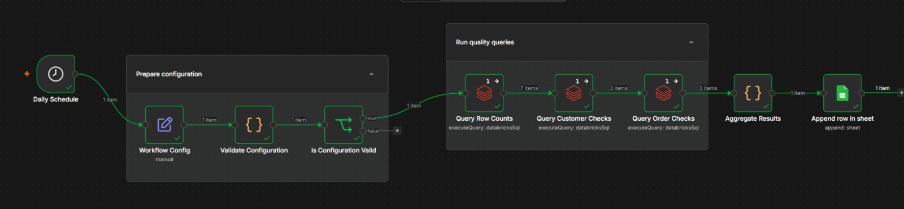

# Customer360 Analytics & Automation Platform


An end-to-end Customer 360 analytics platform built with **Databricks, PySpark, SQL, Power BI, and n8n**.

The project transforms fragmented and inconsistent business data into reliable analytical models, interactive dashboards, and automated data quality monitoring workflows.

It follows the **Medallion Architecture (Bronze → Silver → Gold)** and connects data engineering, business intelligence, and workflow automation into one analytical solution.

---

## Project Overview

Modern businesses generate data across multiple operational systems, including:

- Customer relationship management (CRM)
- Orders and transactions
- Product catalogs
- Customer support tickets
- Website clickstream events

When these sources are disconnected and contain duplicates, missing values, and inconsistent records, producing reliable business reports becomes difficult.

**The objective:** Build a centralized Customer 360 analytics platform that integrates these sources, improves data reliability, automates quality monitoring, and provides actionable business insights.

## Architecture

The solution follows a Medallion Lakehouse approach:

```text
       Raw Business Data
               |
               v
        Bronze Layer
      Raw Data Ingestion
               |
               v
        Silver Layer
   Cleaning & Standardization
               |
               v
          Gold Layer
   Business-Ready Data Models
               |
        +------+------+
        |             |
        v             v
   Power BI       n8n Workflow
   Dashboards     Data Quality Checks
        |             |
        v             v
   Business      Google Sheets
    Insights     Audit Logging
```

## Data Engineering & Medallion Architecture

### 1. Bronze Layer

Responsible for ingesting and preserving the original source data.

- Raw data ingestion.
- Original data preservation.
- Source-level data organization.
- No business transformations.

### 2. Silver Layer

Responsible for improving data quality and preparing datasets for analysis.

- Data cleaning and standardization.
- Duplicate detection and removal.
- Missing value handling.
- Data type corrections.
- Business validation rules.
- Data quality checks.

### 3. Gold Layer

Contains business-ready analytical datasets designed for reporting and analysis.

- 3 Fact Tables.
- 4 Dimension Tables.
- Date Dimension.
- Star Schema data modeling.
- Analytics-ready tables for Power BI.

## Data Quality & Automation

An automated data quality monitoring workflow was implemented using **n8n** to monitor the Gold layer.

### Workflow Capabilities

- Automated checks across 7 Gold tables.
- Monitoring of 884K+ records.
- Detection and classification of data quality issues.
- Automated logging of detected issues.
- Google Sheets integration for audit tracking and monitoring.

This workflow helps make data quality issues more visible and provides a structured way to track validation results.

### Data Quality Findings

The project identified several data quality issues, including:

| Finding | Records |
|---|---:|
| Duplicate Customer IDs | 1,734 |
| Missing Email Addresses | 1,040 |
| Orders Flagged with Customer-Related Data Issues | 11,163 |

These findings helped highlight inconsistencies that could affect customer analytics and business reporting.

## Power BI Dashboards

Three interactive dashboards were developed to provide different perspectives on business performance.

### 1. Executive Overview

Provides a high-level overview of business performance.

**Key metrics and analysis:**

- Revenue
- Orders
- Customers
- Products Sold
- Website Events
- Revenue Trends
- Order Trends
- Revenue by Category
- Customer Growth


---

### 2. Customer360 Analytics

Focuses on customer behavior, purchasing patterns, and engagement.

**Key metrics and analysis:**

- Average Customer Spend
- Average Orders per Customer
- Revenue Distribution
- Customer Segmentation
- Website Activity
- Product Categories


---

### 3. Support Analytics

Evaluates customer support operations and service performance.

**Key metrics and analysis:**

- Resolution Rate
- Average Resolution Time
- Ticket Volume
- Support Agent Performance
- Customer Sentiment
- Issue Types


---

## Data Model

The analytical model follows a **Star Schema** consisting of three fact tables and four dimensions.

### Fact Tables

- Fact Orders
- Fact Clickstream
- Fact Support Tickets

### Dimension Tables

- Dim Customer
- Dim Product
- Dim Support Agent
- Dim Date


---

## Power BI Performance & Refresh

Beyond dashboard development, the project also includes Power BI refresh and performance configuration.

- Configured an Incremental Refresh policy to support refreshing recent data instead of reprocessing the entire historical dataset.
- Used Power BI Performance Analyzer to inspect DAX query execution and visual rendering performance.
- Reviewed report performance to identify opportunities for optimization.

---

## Databricks Workspace

The data engineering and transformation workflow was developed using Databricks and PySpark.


## n8n Automation Workflow

The n8n workflow connects automated data quality checks with Google Sheets for issue classification and audit logging.



---

## Technology Stack

| Technology | Purpose |
|---|---|
| Databricks | Data processing environment |
| PySpark | Data transformation and cleaning |
| SQL | Data querying and validation |
| Power BI | Business intelligence and reporting |
| DAX | Measures and KPI calculations |
| Power Query | Data preparation |
| n8n | Workflow automation and quality monitoring |
| Google Sheets | Data quality audit logging |
| Star Schema | Analytical data modeling |
| Medallion Architecture | Data pipeline organization |

## Business Recommendations

Based on the analytical findings, the project produced four business recommendations supported by a 90-day action plan.

These recommendations focus on improving data reliability, strengthening customer reporting, monitoring customer and support performance, and addressing identified data quality issues.

## Future Improvements

Potential extensions of the platform include:

- CI/CD deployment for data workflows.
- More advanced automated data quality testing.
- Streaming data integration.
- Additional analytical use cases and predictive models.

## Repository Structure

```text
Customer360-Analytics-Platform/
│
├── screenshots/
│   ├── executive-overview.jpeg
│   ├── customer360-dashboard.jpeg
│   ├── support-analytics.jpeg
│   ├── star-schema.jpeg
│   ├── databricks-workspace.jpeg
│   └── n8n-workflow.jpeg
│
├── documentation/
│
├── README.md
├── LICENSE
└── .gitignore
```

## Dataset

This project uses the **Customer 360 Synthetic Dataset** from Kaggle.

**Source:**  
https://www.kaggle.com/datasets/vinaykandimalla/customer-360

The dataset includes:

- CRM Customers
- Orders
- Product Catalog
- Support Tickets
- Clickstream Events

The intentionally inconsistent data provided an opportunity to practice data cleaning, ETL development, data quality validation, and Customer 360 analytics.

## Key Learning Outcomes

Through this project, I gained practical experience in:

- Building end-to-end data pipelines.
- Implementing Medallion Architecture.
- Data transformation using PySpark and SQL.
- Designing Star Schema data models.
- Implementing data validation and quality monitoring.
- Automating workflows using n8n.
- Developing business-focused Power BI dashboards.
- Configuring Incremental Refresh.
- Evaluating report performance using Performance Analyzer.
- Translating analytical findings into business recommendations.

## Author

**Abdallah Tarek**  
Data Analyst | BI Developer

- **LinkedIn:** https://www.linkedin.com/in/abdallaatarekk/
- **GitHub:** https://github.com/abdallaatarekk
- **Portfolio:** https://abdallahportfolio-phi-ten.vercel.app/

---

*Thanks for exploring this project. Feedback and professional connections are always welcome.*
